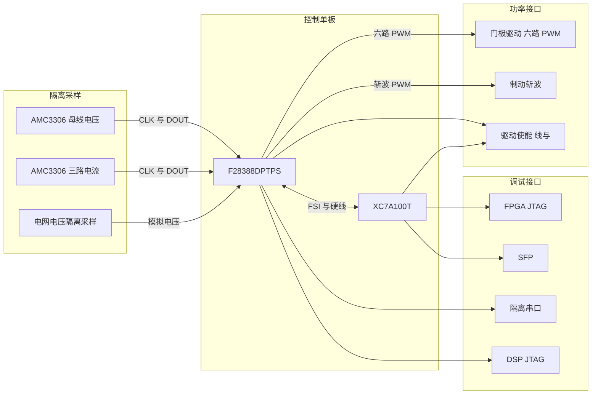
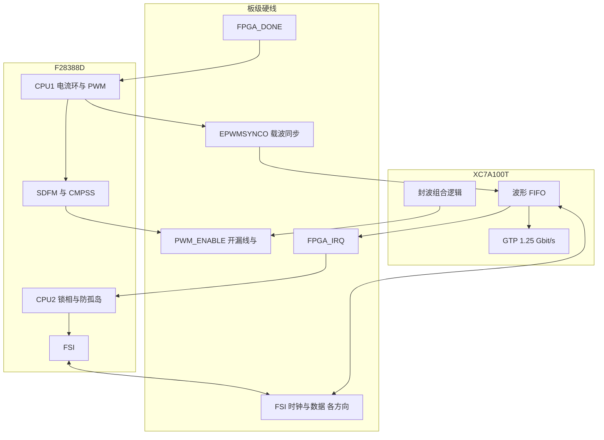

# DSP + FPGA 双芯片方案

最终方案在同一块控制单板上放置一颗 C2000 和一颗 FPGA。DSP 承担功率控制，FPGA 承担 SFP 调试和故障出口扩展。

## 1. 订货型号

工程简称与可订货型号的对应关系如下。

| 工程简称 | 可订货型号 | 说明 |
| --- | --- | --- |
| 28288 | TMS320F28388DPTPS | TI 没有 TMS320F28288。F28388D 是 C2000 双核控制系列里带连接管理器和 SDFM 的型号。PTPS 为 176 脚 HLQFP，-40°C～125°C |
| K7A100 | XC7A100T-2FGG484I | AMD 没有 K7A100，Kintex-7 也没有 XC7K100。XC7A100T 是 Artix-7 里逻辑规模约 100K、且 FGG484 封装引出 GTP 的型号。-2 速度级，工业温度，23 mm × 23 mm |

不采用 XC7A100T-CSG324。该封装没有 GTP，不能直连 SFP。

若后续要把 16 位并行总线做主数据通道，DSP 改为 TMS320F28388DZWT（337 球 nFBGA，16 mm × 16 mm）。176 脚版本已有 EMIF1，但 GPIO 只有 97 个，并口会和 PWM、SDFM 抢引脚。当前单板主链路用 FSI，176 脚足够。

## 2. 两颗芯片各做什么

| 芯片 | 承担 | 不承担 |
| --- | --- | --- |
| TMS320F28388D | AMC3306 解调、六路 PWM、制动斩波、电网锁相、防孤岛算法、母线过压与过流封波、串口调试 | SFP 光口 |
| XC7A100T | SFP、波形缓存与上传、JTAG 调试逻辑、与 DSP 封波线与 | 电流环、PLL、PWM 载波 |

F28388D 内部再拆开：

- CPU1：SDFM 读取、电流环、ePWM、Trip Zone、制动斩波。
- CLA：与 CPU1 并行的电流环或重复控制。
- CPU2：电压环、SOGI-PLL、防孤岛判据、并网状态机。
- Cortex-M4 连接管理器：本板不使用其以太网。光口在 FPGA 上。

## 3. 芯片资源

### 3.1 TMS320F28388D

数据来自 TMS320F2838x 数据手册 SPRSP14E。

| 资源 | 176 脚 PTPS 上的数量 | 本板用量 |
| --- | --- | --- |
| C28x + CLA | 2 × 200 MHz，FPU64，各带 1 个 200 MHz CLA | CPU1 快环，CPU2 锁相与孤岛 |
| ePWM / HRPWM | 32 路 ePWM；ePWM1～ePWM8 共 16 路带 HRPWM，MEP 约 150 ps | 6 路，全部放在带 HRPWM 的模块上 |
| SDFM | 8 通道，每通道 2 个滤波器，比较器可进 Trip Zone | 4 通道：1 路母线电压 + 3 路电流 |
| ADC | 4 个，12 位 3.5 MSPS 或 16 位 1.1 MSPS；176 脚单端最多 20 通道 | 电网电压、温度、驱动故障模拟量 |
| CMPSS | 8 组，内部 DAC | 母线过压硬件比较 |
| SCI | 4 | 1 路隔离串口 |
| FSI | 2 个发送、8 个接收。功能概述给出最高约 200 Mbit/s；电气特性中单沿时钟上限 50 MHz，DDR 时单路数据约 100 Mbit/s | 1 发 1 收，按 50 MHz 时钟布线 |
| SPI | 4 路，最高 50 MHz | 预留，不作为主链路 |
| JTAG | 标准 1149.1，含 EMU0/EMU1 | 14 针仿真座 |
| GPIO | 97（337 球封装为 169） | 见第 5 节 |
| 内核 / IO 电源 | 1.2 V / 3.3 V | 独立 LDO 或 DC/DC |

### 3.2 XC7A100T-2FGG484I

数据来自 7 系列概览 DS180 与 Artix-7 数据手册 DS181。器件最多 8 路 GTP，FGG484 封装只引出 4 路。

| 资源 | 数量 | 本板用量 |
| --- | --- | --- |
| 逻辑单元 | 101440 | SFP MAC、帧缓存、封波组合逻辑 |
| DSP48 | 240 | 备用，不跑功率环 |
| Block RAM | 4860 Kb | SFP 发送队列 |
| GTP | 封装引出 4 路，最高 6.6 Gbit/s | 1 路接 SFP，线速率 1.25 Gbit/s |
| SelectIO | 285，HR，可设 3.3 V | 与 DSP 的 FSI 和 GPIO 同电平直连 |
| CMT | 6（MMCM + PLL） | 由 125 MHz 参考钟分出逻辑时钟 |
| 配置 | Master SPI | 板载 NOR Flash |
| JTAG | 独立于 DSP | 6 针或 14 针座 |

GTP 电源为 MGTAVCC 1.0 V、MGTAVTT 1.2 V。FPGA 内核 VCCINT 与 VCCBRAM 为 1.0 V，VCCAUX 为 1.8 V，接 DSP 的 Bank VCCO 为 3.3 V。

## 4. 需求功能落到哪一侧

| 需求 | 支持情况 | 实现位置 |
| --- | --- | --- |
| 220 V 交流与 300 V 直流双向能量 | 支持。控制律在 DSP，6 路 PWM 足够覆盖双向桥臂 | CPU1 / CPU2 |
| 母线电压 AMC3306 | 支持。SDFM 硬件抽取，时钟由 ePWM 分频，与载波同源 | DSP SDFM |
| 三路电流检测 | 支持。再占 3 个 SDFM 通道，比较器直接封波。8 通道中剩余 4 个备用 | DSP SDFM + Trip Zone |
| 制动能量 PFC 升压 | 支持。电流环在 CPU1 或 CLA，电压环在 CPU2，HRPWM 分辨率约 150 ps | DSP |
| 防孤岛 | 支持。电压、频率窗口和主动频率偏移在 CPU2；跳闸不走软件延时 | CPU2 判据，Trip Zone 出口 |
| 制动电阻 | 支持。独立 ePWM。母线过压时 CMPSS 或 SDFM 比较器强制开通斩波，并关掉桥臂 PWM | DSP |
| ADC / PLL | 支持。电网电压走低延迟 ADC，不用 AMC3306。Sinc3 在 20 MHz、OSR=256 时群延迟约 38 µs，只补偿进电流环 | DSP ADC + CPU2 SOGI-PLL |
| 六路 PWM | 支持，且都可使用 HRPWM | ePWM1～ePWM3 的 A/B，或等价的 6 个输出 |
| 串口调试 | 支持 | DSP SCI，经隔离收发器出板 |
| JTAG 调试 | 支持，两套互不共用 | DSP 14 针，FPGA 独立座 |
| SFP 调试 | 支持。GTP 直连光模块，用于波形和状态上传 | FPGA |

220 V 交流峰值约 311 V。300 V 母线经单相桥逆变，最大约 212 V 有效值。若必须满电压并网，母线要升到约 380–400 V，或增加变压器。这不影响上述引脚分配。

## 5. 单板硬件拓扑

一块控制板分成五个区：辅助电源、隔离采样、DSP、FPGA 与光口、调试连接器。功率主回路不进这块板，只通过隔离采样和门极驱动接口相连。

DSP 与 FPGA 之间不把 PWM 和 AMC3306 码流转到 FPGA。封波是硬线，参数和波形走 FSI。

### 5.1 片间信号

| 信号 | 方向 | 作用 |
| --- | --- | --- |
| FSI_TXCLK / FSI_TXD | DSP → FPGA | 电压、电流、PLL 角度、故障字、控制模式 |
| FSI_RXCLK / FSI_RXD | FPGA → DSP | SFP 下发的调试命令 |
| EPWMSYNCO | DSP → FPGA | 给上传波形打载波时戳 |
| PWM_ENABLE | 两边开漏线与，下拉有效 | DSP 的 Trip 或 FPGA 的看门狗都能封门极 |
| FPGA_IRQ | FPGA → DSP | 一帧调试命令收完 |
| FPGA_DONE | FPGA → DSP | 配置完成前，DSP 不开放 PWM |
| SCI_TX / SCI_RX | DSP → 隔离收发器 | 不经过 FPGA |

FSI 按 50 MHz 单沿时钟布线，包地，长度匹配到同一组。不使用 EMIF。

### 5.2 采样与功率接口

- 4 片 AMC3306 共用 DSP 发出的一只时钟，频率取 20 MHz，从 ePWM 时基分频，不使用独立晶振。
- 每片 AMC3306 的 DOUT 进一个 SDFM 数据脚。过流使用 SDFM 比较器，不经过 CPU 中断。
- 电网电压用隔离放大器的模拟输出进入 ADC。PLL 在 CPU2。锁定标志经 FSI 送给 FPGA，仅用于遥测。
- 六路 PWM 出 DSP，经门极驱动到功率器件。制动斩波单独一路，优先级高于桥臂调制。
- 防孤岛跳闸、过流、母线过压和 FPGA 侧故障共用 PWM_ENABLE，接到驱动器使能。软件停住时驱动器仍被拉死。

### 5.3 时钟、复位与电源

| 对象 | 时钟 | 复位 |
| --- | --- | --- |
| DSP | 20 MHz 无源晶振，内部 PLL 到 200 MHz | 3.3 V 监控器拉 XRSn |
| AMC3306 | DSP 的 ePWM 分频，20 MHz | 随 3.3 V 辅源 |
| FPGA 逻辑 | 125 MHz 差分参考钟经 MMCM | PROGRAM_B 由电源监控释放；DONE 通知 DSP |
| SFP | GTP 使用同一只 125 MHz 参考钟，线速率 1.25 Gbit/s | TX_DISABLE 默认关闭，DONE 之后由 FPGA 打开 |

上电顺序：

1. DSP 的 3.3 V 与 1.2 V，FPGA 的 1.0 V、1.8 V、3.3 V，以及 GTP 的 1.0 V / 1.2 V。FPGA 的 VCCINT 不晚于 VCCAUX 稳定。
2. 释放 DSP 复位。FPGA 从 NOR Flash 自行配置。
3. DSP 看到 FPGA_DONE 后再允许 Trip Zone 退出封波。
4. 任一颗芯片复位或掉电，PWM_ENABLE 保持禁止。

### 5.4 调试连接器

| 连接器 | 接到 | 用途 |
| --- | --- | --- |
| 14 针 JTAG | TMS、TCK、TDI、TDO、TRSTn、EMU0、EMU1 | CCS 调试 DSP |
| FPGA JTAG | TCK、TMS、TDI、TDO | Vivado 调试 FPGA |
| 隔离串口 | SCIA | 参数和故障记录 |
| SFP 笼 | GTP 通道 0 的 TX/RX，加上 I2C、LOS、MOD_ABS、TX_DISABLE | 波形上传 |

两套 JTAG 不串成一条链，避免一颗芯片未上电时拖死另一颗。

## 6. 手册

### 6.1 TMS320F28388D

| 文档 | 文献号 | 地址 |
| --- | --- | --- |
| 产品页 | — | https://www.ti.com/product/TMS320F28388D |
| 数据手册 | SPRSP14E | https://www.ti.com/lit/ds/sprsp14e/sprsp14e.pdf |
| 技术参考手册 | SPRUII0 | https://www.ti.com/lit/pdf/spruii0 |
| 订货信息 F28388DPTPS | 176 脚，-40°C～125°C | https://www.ti.com/product/TMS320F28388D |

数据手册看封装、SDFM/ePWM 数量和电气特性。技术参考手册看 SDFM、ePWM Trip Zone、ADC 和 FSI 的寄存器。

### 6.2 XC7A100T

| 文档 | 文献号 | 地址 |
| --- | --- | --- |
| 7 系列概览，含封装与 GTP 数量 | DS180 | https://docs.amd.com/v/u/en-US/ds180_7Series_Overview |
| Artix-7 直流与开关特性 | DS181 | https://docs.amd.com/v/u/en-US/ds181_Artix_7_Data_Sheet |
| GTP 收发器，SFP 按这一本 | UG482 | https://docs.amd.com/v/u/en-US/ug482_7Series_GTP_Transceivers |
| 配置方式，Master SPI | UG470 | https://docs.amd.com/v/u/en-US/ug470_7Series_Config |
| 引脚与封装 | UG475 | https://docs.amd.com/v/u/en-US/ug475_7Series_Pkg_Pinout |

FGG484 的 GTP 只有 4 路。原理图阶段用 UG475 核对 MGT 引脚，不要按“器件最多 8 路 GTP”来分配封装里没有引出的通道。
